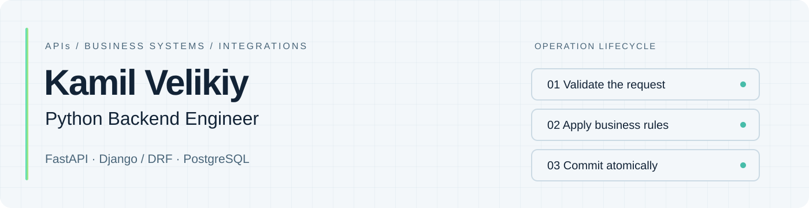

<picture>
  <source media="(prefers-color-scheme: dark)" srcset="assets/header-dark.svg">
  <source media="(prefers-color-scheme: light)" srcset="assets/header-light.svg">
  
</picture>

[English](README.md) · [Русский](README.ru.md) 
[LinkedIn](https://www.linkedin.com/in/kamil-velikiy/) · [Telegram](https://t.me/foreach_dump) · [CV on hh.ru](https://obninsk.hh.ru/resume/ca6f82d7ff0cf787bc0039ed1f50714c6a7474)

## Python backend for APIs and business systems

I build Python APIs, integrations and background workflows, with **2+ years of commercial backend experience** in retail B2B platforms and a mobile MVP. My focus is data integrity: explicit business rules, safe retries, access control and tests around failure paths.

At **Basis IT**, I implemented operation locks and recovery, improved Keycloak registration and account reconciliation, and extended analytics APIs with indexed lookups and caching. At **Men In Dev**, I was the sole backend developer for a mobile MVP, from API and PostgreSQL design to integrations and launch support.

Based in **Moscow, Russia**. Currently working on independent projects; open to remote **Python backend** and **Python / React full-stack** roles.

## Selected engineering work

These case studies describe projects whose source repositories are maintained separately. Each explains the problem, implementation choices and testing scope.

| Project | Engineering focus | Stack |
| :--- | :--- | :--- |
| **[Sfera](case-studies/sfera.md)** — personal learning and collaboration platform | Version-checked batch updates, object-level permissions, document history, import rollback and background exports | Django/DRF, FastAPI, PostgreSQL, Celery, React/TypeScript |
| **[PDF Label Service](case-studies/pdf-label-service.md)** — local label-generation MVP | Transactional code reservation, duplicate prevention and explicit recovery after interrupted exports | FastAPI, SQLite, pypdf |
| **[AI English Companion](case-studies/ai-english-companion.md)** — Telegram practice MVP | AI API integration, usage accounting and payment-event deduplication | Python, aiogram, SQLite, Pytest |
| **[Ping](case-studies/ping.md)** — reminders and a personal workspace | Confirm-before-save reminders, persisted scheduling, owner-scoped data and backup/restore tooling | FastAPI, PostgreSQL, Docker, React/TypeScript |

## Public code to explore

Start with **[altpkg-diff](https://github.com/Raphailinc/altpkg-diff)** for Python library and CLI design, or **[Task Delay Service](https://github.com/Raphailinc/Task-Delay-Service)** for Django APIs and asynchronous jobs.

| Repository | What to look at |
| :--- | :--- |
| [altpkg-diff](https://github.com/Raphailinc/altpkg-diff) | Parallel HTTP requests, retry policy, package comparison, JSON/Markdown reports and CLI exit codes |
| [Task Delay Service](https://github.com/Raphailinc/Task-Delay-Service) | DRF validation, recipient filtering, timezone-aware scheduling and Celery tasks |
| [Pulse](https://github.com/Raphailinc/Pulse) | Flask app factory, authentication, post ownership, uploads and API tests |
| [Car API](https://github.com/Raphailinc/Car-API) | Marshmallow validation, VIN uniqueness, CRUD error handling and isolated database tests |
| [Taskboard](https://github.com/Raphailinc/Taskboard) | Django models, forms, task filters and attachment handling |
| [Document Detector](https://github.com/Raphailinc/Document-Detector) | OpenCV contour detection, perspective transforms and synthetic-image tests |

These are focused portfolio and learning projects. Their READMEs cover setup, tests and scope.

## Tools I work with

**Backend:** Python, FastAPI, Django REST Framework, Flask, REST APIs. 
**Data and jobs:** PostgreSQL, SQL, SQLite, Redis, Celery; Tarantool and Keycloak in commercial work. 
**Delivery and verification:** Docker, Docker Compose, Git, CI/CD, Pytest. 
**Across the interface:** React, TypeScript, JavaScript, API integration and error states.

## Background and contact

IATE, National Research Nuclear University **MEPhI**: bachelor's degree in Information Systems and Technologies (2024), master's degree in Computer Science and Engineering (2026); postgraduate studies ongoing.

For roles, projects or a technical conversation: **[Telegram — @foreach_dump](https://t.me/foreach_dump)** or **[LinkedIn](https://www.linkedin.com/in/kamil-velikiy/)**.
