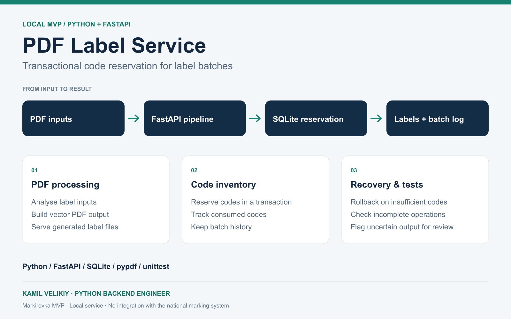
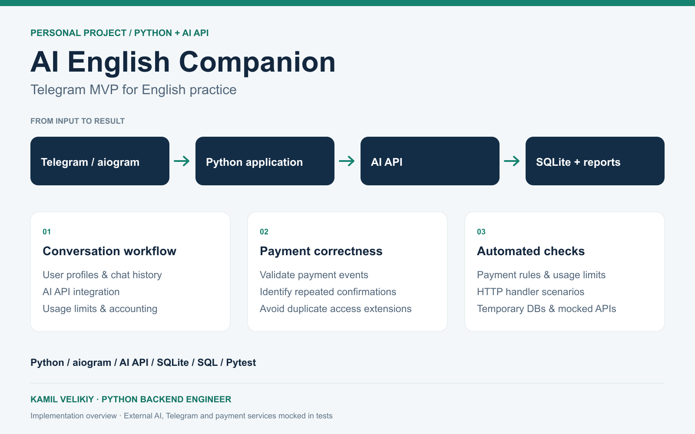

# Engineering case studies

[Profile](../README.md) · [Русский](README.ru.md) · [Public project guide](../PROJECTS.md)

I build Python APIs and business workflows with explicit rules for permissions, concurrent changes and recovery. These four projects show how I approach those problems. Each case explains the implementation and the limits of its verification.

## Sfera

**Keeping collaborative edits consistent.** A stale browser tab must not overwrite newer work. Version checks, database locks and transactional batches protect spreadsheet changes; object permissions and document history make edits controlled and recoverable.

[Read the case](sfera.md) · Django/DRF, FastAPI, PostgreSQL, Celery, React/TypeScript

## PDF Label Service

**Reserving marking codes before export.** A PDF may exist even when its export was interrupted. A transactional reservation ledger and an explicit review state keep uncertain batches from silently releasing their codes for reuse.

[Read the case](pdf-label-service.md) · FastAPI, SQLite, pypdf

## AI English Companion

**Accounting for paid AI access.** Replayed payment confirmations must not extend a subscription twice. Persisted event identifiers, atomic access changes and usage accounting connect the Telegram experience to billing rules.

[Read the case](ai-english-companion.md) · Python, aiogram, SQLite, Pytest

## Ping

**Turning an ambiguous message into a persisted reminder.** The user confirms the proposed text and time before saving. PostgreSQL preserves the schedule across restarts, while owner-scoped APIs keep personal workspace data separate.

[Read the case](ping.md) · FastAPI, PostgreSQL, Docker, React/TypeScript

The images are architecture illustrations. These pages document implementations whose source repositories are maintained separately. For code you can clone and run, start with the [public project guide](../PROJECTS.md).
