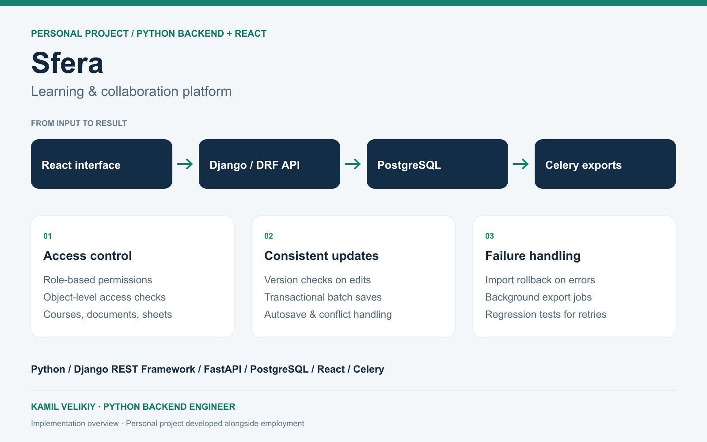

# Sfera — consistent updates in a collaboration platform

[Profile](../README.md) · [All case studies](README.md)

**Personal project · Python backend and React/TypeScript · Developed alongside employment since March 2024**

## Problem

A platform for courses, documents and spreadsheets needs to preserve user changes while enforcing access rules. A stale browser tab, repeated save request or failed import can otherwise overwrite work or leave a workbook partially updated.

## My implementation

I built Django REST Framework APIs and PostgreSQL models for learning and collaboration, with FastAPI services at platform boundaries and React/TypeScript interfaces.

- **Version-checked writes.** Spreadsheet batches carry a base version. The service checks the current version under a database lock and rejects conflicting updates instead of silently replacing newer data.
- **Transactional operations.** Related cell changes and import operations use transactions so validation errors can roll back changes together.
- **Repeat-request handling.** Client request identifiers support replay handling in the batch-update workflow.
- **Access at the object boundary.** Owner, editor, commenter and viewer roles control operations on workbooks and documents.
- **Document history.** Autosave, stored versions and conflict handling make editing recoverable.
- **Background exports.** Celery jobs separate export work from interactive API requests.

## Verification in the codebase

Automated tests exercise stale versions, access to another user's objects, repeated requests, import rollback, and export errors. Frontend checks cover save/error states and API integration. The presence of these tests describes their scope; it does not assert that every platform service has passed an independent production audit.

## Engineering tradeoff

Version checks make conflicts explicit and keep the persistence model understandable. They do not provide character-level real-time collaborative merging. Presence indicators and version control solve different problems.

**Stack:** Python, Django REST Framework, FastAPI, PostgreSQL, Celery, React, TypeScript.

This page is an implementation case study. The source repository is maintained separately. The diagram illustrates architecture rather than a live product screenshot.
